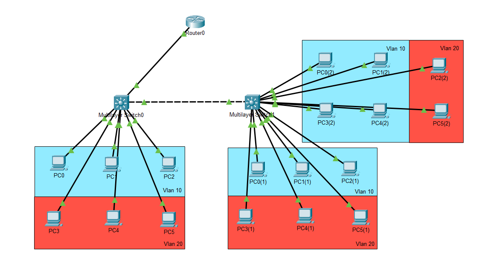

# Enterprise VLAN Segmentation and Inter-VLAN Routing Lab

A Cisco Packet Tracer project demonstrating VLAN segmentation, IEEE 802.1Q trunking, DHCP configuration, and router-on-a-stick inter-VLAN routing in a simulated enterprise LAN.

## Project Overview

This project simulates an enterprise network in which HR and Management devices are separated into different VLANs while retaining the ability to communicate through a central router.

The network consists of a Cisco 2901 router, two Cisco 3560 multilayer switches, and multiple end devices.

Router0 provides DHCP services and performs inter-VLAN routing using 802.1Q subinterfaces. The switches provide VLAN segmentation and trunk connectivity.

The implementation was verified through DHCP assignment, gateway reachability, and successful ping tests between VLANs.

## Objectives

* Segment end devices into separate VLANs.
* Configure access ports and 802.1Q trunk links.
* Implement router-on-a-stick inter-VLAN routing.
* Configure DHCP pools for multiple IPv4 subnets.
* Verify VLAN membership and trunk operation.
* Test gateway reachability and end-to-end connectivity.
* Document the configuration and verification process.

## Network Topology

### Devices

| Device      | Model      | Role                                  |
| ----------- | ---------- | ------------------------------------- |
| Router0     | Cisco 2901 | DHCP services and inter-VLAN routing  |
| Switch0     | Cisco 3560 | VLAN access connectivity and trunking |
| Switch1     | Cisco 3560 | VLAN access connectivity and trunking |
| End devices | PCs        | Clients in VLAN 10 and VLAN 20        |

## Network Architecture

Router0 connects to Switch0 through Router0 GigabitEthernet0/0 and Switch0 GigabitEthernet0/1.

Switch0 connects to Switch1 through GigabitEthernet0/2 on both switches.

Router0 uses subinterfaces to provide the default gateways for the two VLANs. IEEE 802.1Q trunk links carry VLAN traffic between the router and switch and between the switches.

## VLAN and IP Addressing

| VLAN ID | VLAN Name  | Network         | Subnet Mask   | Default Gateway |
| ------- | ---------- | --------------- | ------------- | --------------- |
| 10      | HR         | 192.168.10.0/24 | 255.255.255.0 | 192.168.10.1    |
| 20      | Management | 192.168.20.0/24 | 255.255.255.0 | 192.168.20.1    |

## Technologies Used

* Cisco Packet Tracer
* Cisco IOS CLI
* VLANs
* IEEE 802.1Q trunking
* Router-on-a-stick
* DHCP
* IPv4 addressing and subnetting
* ICMP
* Cisco Discovery Protocol (CDP)
* Per-VLAN Spanning Tree (PVST)

## Implementation

### 1. VLAN Configuration

VLAN 10 (`hr`) and VLAN 20 (`management`) were configured on both switches. Access ports were assigned to the appropriate VLANs according to the network design.

### 2. Trunk Configuration

IEEE 802.1Q trunking was configured on the router-facing and inter-switch links. The inter-switch trunk carries VLANs 10 and 20.

Trunk status and allowed VLANs were checked using Cisco IOS verification commands.

### 3. Inter-VLAN Routing

Router0 uses the following subinterfaces:

| Interface             | VLAN | IP Address      |
| --------------------- | ---- | --------------- |
| GigabitEthernet0/0.10 | 10   | 192.168.10.1/24 |
| GigabitEthernet0/0.20 | 20   | 192.168.20.1/24 |

The subinterfaces use IEEE 802.1Q encapsulation to associate incoming and outgoing traffic with the correct VLAN.

The router provides Layer 3 connectivity between the two IPv4 subnets.

### 4. DHCP Configuration

Separate DHCP pools were configured on Router0 for VLAN 10 and VLAN 20.

The following address ranges were excluded from dynamic assignment:

* VLAN 10: 192.168.10.1–192.168.10.10
* VLAN 20: 192.168.20.1–192.168.20.10

All PCs successfully received IP configuration through DHCP.

## Verification and Testing

The following commands were used to inspect and verify the network configuration.

| Command                   | Purpose                                   |
| ------------------------- | ----------------------------------------- |
| `show running-config`     | Inspect the device configuration          |
| `show vlan brief`         | Verify VLANs and access-port membership   |
| `show interfaces trunk`   | Inspect trunk status and allowed VLANs    |
| `show ip interface brief` | Check interface status and IP addressing  |
| `show ip route`           | Inspect the routing table                 |
| `show cdp neighbors`      | Identify directly connected Cisco devices |

### Test Results

| Test                                      | Result            |
| ----------------------------------------- | ----------------- |
| DHCP address assignment                   | Passed on all PCs |
| Default gateway assignment                | Passed            |
| VLAN 10 PC to gateway                     | Successful        |
| VLAN 20 PC to gateway                     | Successful        |
| Communication between VLAN 10 and VLAN 20 | Successful        |

These results confirm successful DHCP assignment, gateway reachability, and inter-VLAN communication in the simulated environment.

## Project Files

| Path                                   | Description                  |
| -------------------------------------- | ---------------------------- |
| `topology/vlan-lab.pkt`                | Cisco Packet Tracer project  |
| `topology/vlan-topology.png`           | Network topology image       |
| `configurations/router0.txt`           | Router configuration export  |
| `configurations/switch0.txt`           | Switch0 configuration export |
| `configurations/switch1.txt`           | Switch1 configuration export |
| `documentation/ip-addressing-table.md` | IP addressing plan           |
| `documentation/vlan-port-mapping.md`   | VLAN and port mapping        |
| `screenshots/`                         | Verification evidence        |

## Skills Demonstrated

* VLAN creation and segmentation
* Switch access-port configuration
* IEEE 802.1Q trunking
* Router-on-a-stick inter-VLAN routing
* DHCP configuration and verification
* IPv4 addressing and subnetting
* Network connectivity testing
* Cisco IOS configuration inspection
* CDP neighbor discovery
* Technical documentation

## Future Improvements

Potential extensions include:

* Secure device administration using SSH.
* Port security on access ports.
* DHCP snooping and Dynamic ARP Inspection where supported.
* Tighter trunk allowed-VLAN lists.
* Spanning-tree root bridge planning.
* SNMP-based network monitoring and alerting.
* Documented fault scenarios for troubleshooting practice.

These are planned improvements, not features claimed to be implemented in this version.

## How to Use

1. Download the `.pkt` file from the `topology/` directory.
2. Open it using a compatible version of Cisco Packet Tracer.
3. Inspect the router and switch configurations.
4. Use the verification commands documented above.
5. Repeat the DHCP and connectivity tests to reproduce the results.

## Author

Created as a hands-on networking project to practise enterprise LAN configuration, inter-VLAN routing, and network verification using Cisco Packet Tracer.

## Portfolio

Explore my other networking projects in my
[Network Engineering Projects portfolio](https://github.com/edwin1data/Network-Engineering-Projects).
